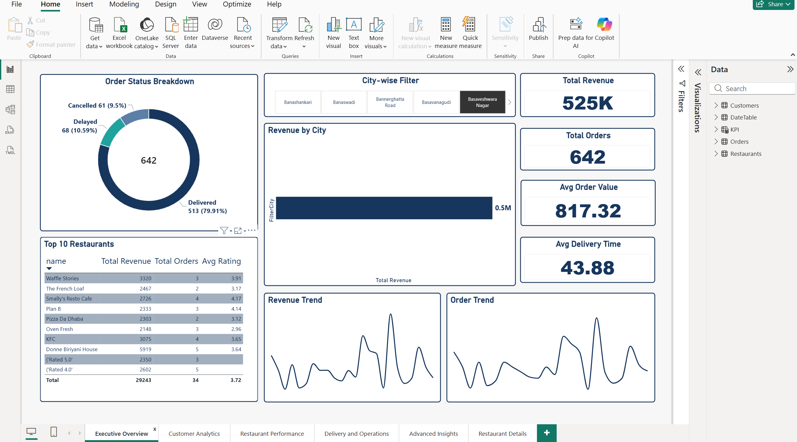
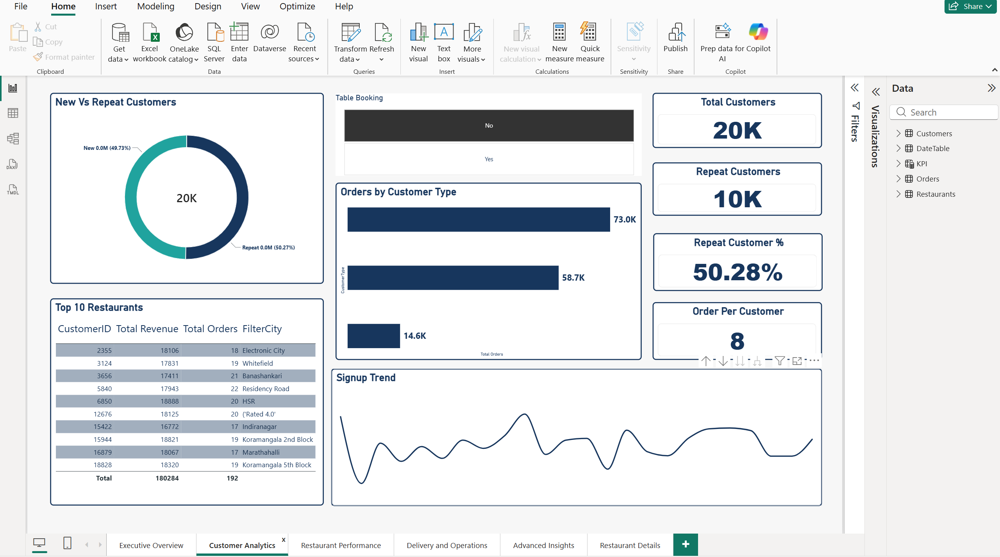
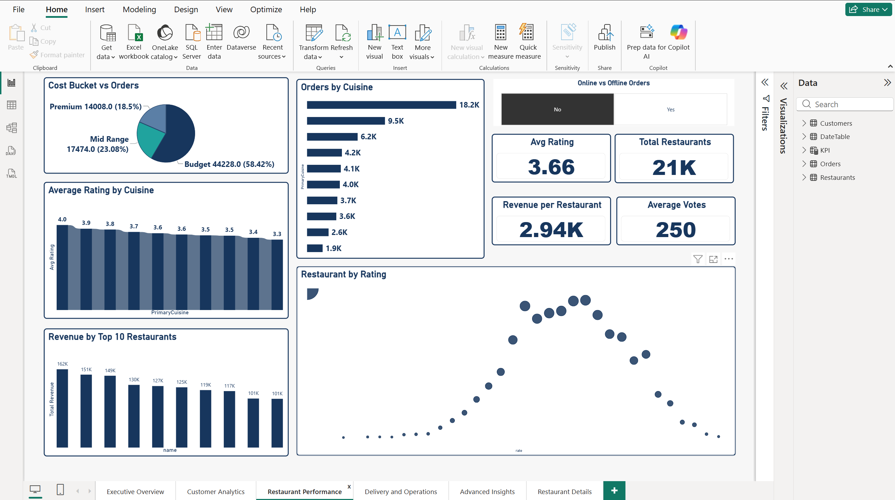
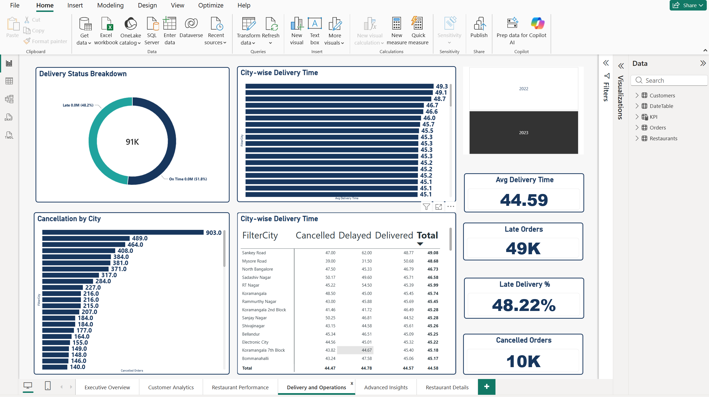
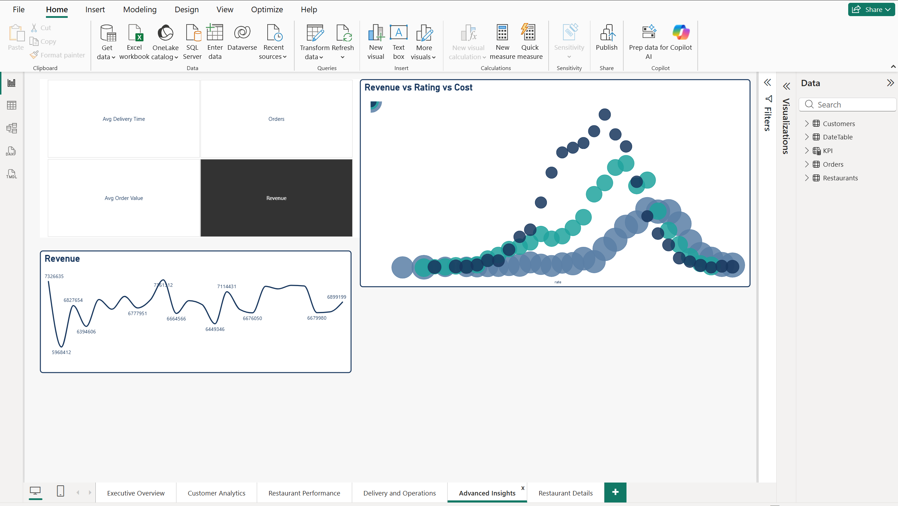
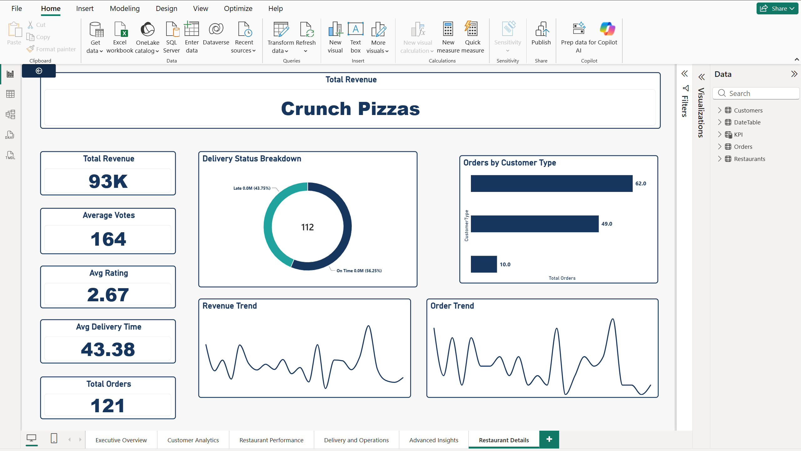

# Food Delivery Analytics Dashboard (Power BI)

A six-page Power BI dashboard that analyses food delivery orders, customers, restaurants and delivery operations. It uses a custom navy and teal theme on a light background.



## Business questions it answers
- How much revenue and how many orders is the business generating, and how are they trending?
- Who are the customers, and how many of them come back?
- Which restaurants and cuisines perform best on revenue, rating and order volume?
- How well is delivery performing, and where are orders late or cancelled?
- How does a single restaurant perform on its own?

## Dashboard pages

| # | Page | What it shows |
|---|------|---------------|
| 1 | **Executive Overview** | Total revenue, total orders, average order value and average delivery time. Order status breakdown, revenue by city, revenue and order trends, top 10 restaurants, and a city filter. |
| 2 | **Customer Analytics** | Total, repeat and new customers, repeat customer %, orders per customer, signup trend, orders by customer type, and a table booking filter. |
| 3 | **Restaurant Performance** | Cost bucket split, orders and average rating by cuisine, revenue by top 10 restaurants, a restaurant-by-rating scatter plot, and an online vs offline order filter. |
| 4 | **Delivery and Operations** | Delivery status breakdown, city-wise delivery time (chart and table), cancellations by city, late orders, late delivery % and cancelled orders, with a year filter. |
| 5 | **Advanced Insights** | Metric selector (revenue, orders, average order value, delivery time), revenue trend, and a bubble chart of revenue vs rating vs cost. |
| 6 | **Restaurant Details** | A single-restaurant view with revenue, votes, rating, delivery time, orders, delivery status and trends. |

## Screenshots

### Customer Analytics


### Restaurant Performance


### Delivery and Operations


### Advanced Insights


### Restaurant Details


## Key measures (DAX)
The report has measures for revenue, orders, customers, restaurants, ratings, votes and delivery performance. The main calculated ones are below.

**Total Orders** counts the order IDs.
```dax
Total Orders =
COUNT(Orders[OrderID])
```

**Late Orders** counts orders whose delivery status is "Late".
```dax
Late Orders =
CALCULATE([Total Orders], Orders[Delivery Status] = "Late")
```

**Late Delivery %** is late orders as a share of all orders (Total Orders is the denominator).
```dax
Late Delivery % =
DIVIDE([Late Orders], [Total Orders])
```

**Repeat Customers** counts customers whose type is Premium or Returning. This is how "repeat" is defined in this report.
```dax
Repeat Customers =
CALCULATE(
    COUNTROWS(Customers),
    Customers[CustomerType] IN {"Premium", "Returning"}
)
```

**Orders Per Customer** is total orders divided by total customers.
```dax
Orders Per Customers =
DIVIDE([Total Orders], [Total Customers])
```

**Average Order Value** is revenue per order.
```dax
Avg Order Value =
DIVIDE([Total Revenue], [Total Orders])
```

**Revenue per Restaurant** is total revenue divided by the number of restaurants.
```dax
Revenue per Restaurant =
DIVIDE([Total Revenue], [Total Restaurants])
```

`DIVIDE` is used for every ratio, so a zero or blank denominator returns a blank instead of an error.

## Data model
The model follows a star schema. `Orders` is the central table, and three dimension tables each connect to it with a one-to-many relationship, filtering in a single direction.

| Table | Role | Notable columns |
|-------|------|-----------------|
| `Orders` | Fact table | OrderID, CustomerID, OrderDate, OrderStatus, OrderValue, DeliveryTimeMins, Delivery Status, Order Month |
| `Customers` | Dimension | CustomerID, CustomerName, CustomerType, City, FilterCity |
| `Restaurants` | Dimension | name, cuisines, location, CityGroup, CostForTwo, Cost Bucket, book_table, dish_liked |
| `DateTable` | Dimension (calendar) | Date, Day, MonthName, MonthNo, Quarter, Year |
| `KPI` | Standalone measures table | Holds the report's measures |

Calculated columns: `Delivery Status`, `Order Month`, `Cost Bucket` and `FilterCity`.

## Data source
This project uses sample data for practice and portfolio purposes. The raw source files are not included separately; the data is embedded in the Power BI file.

## Tools and skills
- Power BI Desktop
- DAX measures and calculated tables
- Power Query for loading and transforming data
- Data modelling and relationships
- Dashboard design: custom colour theme, KPI cards, slicers, and cross-filtering between visuals

## Design
The report uses a custom navy and teal theme on a light background. The theme file is included in `theme/NavyTeal_theme_food_v2.json`. To use it: **View → Themes → Browse for themes** in Power BI Desktop.

| Colour | Hex |
|--------|-----|
| Navy | `#17365D` |
| Teal | `#20A39E` |
| Page background | `#F4F7FA` |
| Charcoal text | `#263238` |

## Key insights
Figures are read from the dashboard. Where a slicer was applied, it is noted in brackets.

1. **Customers are split almost evenly between new and repeat.** Repeat customers are about 10K of 20K, or 50.28% (new customers 49.73%). In this report "repeat" means customers whose type is Premium or Returning.
2. **Budget restaurants drive most orders.** Budget restaurants account for 58.42% of orders (about 44.2K), Mid Range 23.08% and Premium 18.5% *(Online vs Offline slicer set to "No")*.
3. **One cuisine leads by a wide margin.** The top cuisine has 18.2K orders, almost double the second at 9.5K *(Online vs Offline slicer set to "No")*.
4. **Ratings across top cuisines are tightly grouped.** Average rating across the ten cuisines shown sits between 3.3 and 4.0 *(Online vs Offline slicer set to "No")*.
5. **Nearly half of orders are late.** Late Delivery % is 48.22% and average delivery time is about 44.6 minutes, while the slowest city averages about 49 minutes *(year 2023 selected)*.
6. **One city stands out for cancellations.** The city with the most cancellations has 903, nearly double the next highest at 489. Total cancelled orders are about 10K *(year 2023 selected)*.
7. **Revenue fluctuates within a band.** Revenue across the plotted periods ranges from about 5.97M at its lowest to about 7.36M at its peak.

## Known limitations
- Some rows contain malformed text (for example, values beginning with `('Rated`) that came with the source data and was not cleaned. They appear in a few tables and can affect rankings and totals slightly. In a production version they would be removed in Power Query.
- Some donut chart labels show values in millions (for example `0.0M`) because of the label number format.

## How to open
1. Install Power BI Desktop (free).
2. Download `Food_Delivery_Dashboard.pbix` from this repository.
3. Open it in Power BI Desktop. Use the slicers on each page to filter the data.

## Repository structure
```
├── Food_Delivery_Dashboard.pbix
├── README.md
├── screenshots/
├── theme/
│   └── NavyTeal_theme_food_v2.json
```

## Author
Tanmay Wadekar · [GitHub](https://github.com/tanmaywadekar27)
